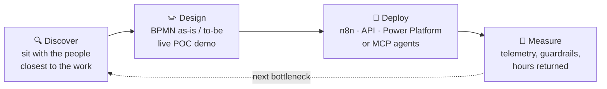

<!-- Header -->
<p align="center">
  
</p>

<p align="center">
  <a href="https://github.com/masonnguyen131">
    
  </a>
</p>

<p align="center">
  <a href="https://www.linkedin.com/in/masonnguyen13/"></a>
  <a href="https://masonportfolio.vercel.app/"></a>
  <a href="mailto:masonnguyen131@gmail.com"></a>
  
</p>

---

### 👋 About me

I build automation workflows that teams trust enough to make decisions they can rely on. Applied AI is where that plays out for me. I sit with the people closest to a workflow, design the fix, deploy it and measure what it saves them. Lately that means building **agentic workforces with guardrails**, so the work gets faster without getting riskier.

At **Redbridge Capital**, a Melbourne investment manager for the Susan McKinnon Foundation and a family office, I take AI automation and agentic workflows from discovery to production. Before that I worked across startups, scale-ups and go-to-market strategy.

```yaml
mason:
  based_in:   Melbourne, Australia 🇦🇺
  works_on:   [AI automation, agentic workflows, finance operations]
  ships_with: [Claude Code, Claude Skills, MCP, n8n, Power Platform, Python, SQL]
  studying:   Bachelor of Business Analytics, Deakin (Dean's Merit List) · CFA Program candidate
  speaks:     [English, Mandarin (HSK 5)]
  open_to:    AI transformation, fundraising and growth conversations
```

### 📈 Impact so far

| Result | What it was |
|:---:|:---|
| **5 / 5** | POCs taken to production in my first four months at Redbridge Capital |
| **-40%** | Operations time per task after go-live |
| **+25%** | Team workload capacity from the same automations |
| **-35%** | Order fulfilment time from SQL ETL pipelines in Redshift (Thermomix) |
| **+25%** | Revenue from Python and SQL customer segmentation models (Myer) |

### 🧭 How I work



The tool follows the risk. A low-risk workflow might be a quick n8n flow; anything touching financial data gets test harnesses, telemetry and clear limits on what an agent is allowed to act on.

### 🔭 Right now

- 🤖 Running a shared **Claude Code / Claude Skills** harness as my team's source of truth
- 📊 Building an equities pricing tool with Claude Code, Claude Skills and BPMN
- 🏦 Consolidating capital call, distribution and trade records across a multi-asset portfolio
- 📚 Working through the CFA Program

### 🛠️ Toolbox

**AI & automation**

<p>
  
  
  
  
  
  
  
</p>

**Data & analytics**

<p>
  
  
  
  
  
  
  
</p>

**Code & cloud**

<p>
  <a href="https://skillicons.dev"></a>
</p>

**Business systems:** Xero · Microsoft 365 · Salesforce · Oracle NetSuite · SAP · Shopify · HubSpot · Airtable · Jira · Confluence

### 🚀 Featured work

| Project | What it does | Stack |
|:---|:---|:---|
| **Capital Vision analytics platform** | Automated pipelines feeding macro and commercial property data into ML forecasting, plus a Claude API chatbot so non-technical buyers can self-serve property Q&A. *Live walkthrough on request.* | Python · PostgreSQL · AWS S3 · n8n · React · Claude API |
| [**Stock Price Predictor**](https://github.com/masonnguyen131/stockprecpp) | Desktop app that reads any stock CSV and switches between linear regression, moving average and exponential smoothing forecasts on a candlestick chart | C++ · SplashKit |
| [**Rental AI**](https://github.com/masonnguyen131/Rental-AI) | AI rental helper built for an IBM hackathon, with map-based search | JavaScript · Google Maps API · LLM API |
| [**House Price Prediction**](https://github.com/masonnguyen131/House_price_Prediction) | Compared linear regression, MLP, GRU and LSTM models on ~20,000 Washington house sales | Python · Keras · Jupyter |
| [**Weather Recognition**](https://github.com/masonnguyen131/Weather_Recognition) | Deep learning image classifier for five weather phenomena across 2,726 images | Python · Keras · Jupyter |

### 🐍 Contribution activity

<p align="center">
  <picture>
    <source media="(prefers-color-scheme: dark)" srcset="https://raw.githubusercontent.com/masonnguyen131/masonnguyen131/output/github-contribution-grid-snake-dark.svg" />
    <source media="(prefers-color-scheme: light)" srcset="https://raw.githubusercontent.com/masonnguyen131/masonnguyen131/output/github-contribution-grid-snake.svg" />
    
  </picture>
</p>

### 🤝 Let's talk

If you're working on **AI transformation, fundraising or growth**, I'd like to hear about it. The fastest way to reach me is [LinkedIn](https://www.linkedin.com/in/masonnguyen13/) or [email](mailto:masonnguyen131@gmail.com).

<p align="center">
  
</p>
