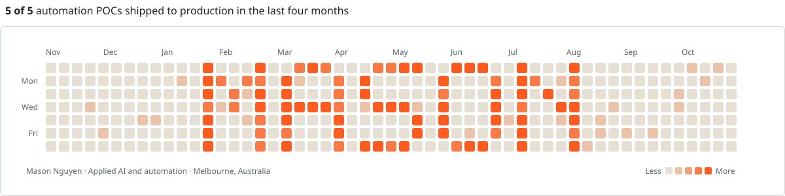
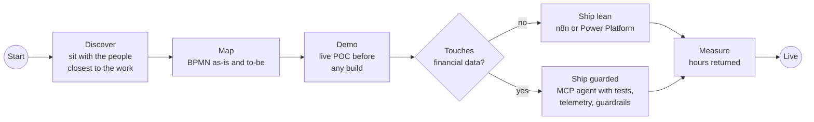

  <picture>
    <source media="(prefers-color-scheme: dark)" srcset="assets/header-dark.svg" />
    
  </picture>

  <a href="https://www.linkedin.com/in/masonnguyen13/">LinkedIn</a>
  &nbsp;·&nbsp;
  <a href="https://masonportfolio.vercel.app/">Portfolio</a>
  &nbsp;·&nbsp;
  <a href="mailto:masonnguyen131@gmail.com">Email</a>
  &nbsp;·&nbsp;
  Melbourne, Australia

 

I build automation that teams trust enough to make real decisions on. I sit with the people closest to a workflow, design the fix, deploy it and measure what it saves them.

At **Redbridge Capital**, a Melbourne investment manager for the Susan McKinnon Foundation and a family office, I take AI automation and agentic workflows from discovery to production. Lately that means agentic workforces with guardrails, so the work gets faster without getting riskier.

 

| **5 / 5** | **-40%** | **+25%** |
|:---:|:---:|:---:|
| POCs live in my first 4 months | operations time per task | team workload capacity |

 

### How I work

### Stack

<picture>
  <source media="(prefers-color-scheme: dark)" srcset="https://skillicons.dev/icons?i=py,postgres,aws,gcp,ts,react,nodejs,git&theme=dark" />
  
</picture>

Claude Code &nbsp;·&nbsp; MCP agents &nbsp;·&nbsp; n8n &nbsp;·&nbsp; Power Platform &nbsp;·&nbsp; Copilot Studio &nbsp;·&nbsp; Power BI &nbsp;·&nbsp; BigQuery &nbsp;·&nbsp; dbt &nbsp;·&nbsp; SQL

### Selected work

**Capital Vision analytics platform** &nbsp;·&nbsp; Property and macro data pipelines feeding ML forecasts, with a Claude API chatbot for non-technical buyers. *Walkthrough on request.* 
[**Stock Price Predictor**](https://github.com/masonnguyen131/stockprecpp) &nbsp;·&nbsp; C++ app comparing three forecasting models on a live candlestick chart. 
[**Rental AI**](https://github.com/masonnguyen131/Rental-AI) &nbsp;·&nbsp; AI rental helper with map-based search, built for an IBM hackathon. 
[**House Price Prediction**](https://github.com/masonnguyen131/House_price_Prediction) &nbsp;·&nbsp; Regression, MLP, GRU and LSTM compared on ~20,000 sales.

 

  <picture>
    <source media="(prefers-color-scheme: dark)" srcset="https://raw.githubusercontent.com/masonnguyen131/masonnguyen131/output/github-contribution-grid-snake-dark.svg" />
    
  </picture>

  Working on AI transformation, fundraising or growth? <a href="https://www.linkedin.com/in/masonnguyen13/">Let's talk.</a>

