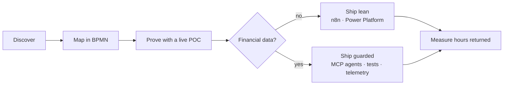

<a href="https://masonportfolio.vercel.app/">
  <picture>
    <source media="(prefers-color-scheme: dark)" srcset="assets/header-dark.svg" />
    
  </picture>
</a>

 

`(02) MANIFESTO`

I build automation that teams trust enough to make real decisions on. I sit with the people closest to a workflow, find the real bottleneck, design the fix, deploy it and measure what it saves them. Lately that means *agentic workforces with guardrails*, so the work gets faster without getting riskier.

| **5 / 5** | **-40%** | **+25%** |
|:--|:--|:--|
| POCs live in my first four months at Redbridge Capital | operations time per task | team workload capacity |

 

`(03) TODAY ON SET`

<a href="https://masonportfolio.vercel.app/">
  <picture>
    <source media="(prefers-color-scheme: dark)" srcset="https://raw.githubusercontent.com/masonnguyen131/masonnguyen131/output/callsheet-dark.svg" />
    
  </picture>
</a>

A fresh call sheet prints every morning at 6am Melbourne time: live weather, golden hour, tonight's moon and a line from how I work.

 

`(04) HOW THE WORK MOVES`

 

`(05) NOW SHOWING`

| | | |
|:--|:--|:--|
| **Capital Vision platform** | Property and macro pipelines into ML forecasts, with a Claude API chatbot for buyers | *Walkthrough on request* |
| [**Stock Price Predictor**](https://github.com/masonnguyen131/stockprecpp) | Three forecasting models on one candlestick chart | C++ |
| [**Rental AI**](https://github.com/masonnguyen131/Rental-AI) | AI rental helper with map search, built for an IBM hackathon | JavaScript |
| [**House Price Prediction**](https://github.com/masonnguyen131/House_price_Prediction) | Regression, MLP, GRU and LSTM on ~20,000 sales | Python |

 

`(06) THE REEL`

<picture>
  <source media="(prefers-color-scheme: dark)" srcset="https://raw.githubusercontent.com/masonnguyen131/masonnguyen131/output/reel-dark.svg" />
  
</picture>

 

**Tools** &nbsp; Claude Code · Claude Skills · MCP · n8n · Power Platform · Python · SQL · Power BI · BigQuery · dbt

**Elsewhere** &nbsp; [Portfolio](https://masonportfolio.vercel.app/) · [LinkedIn](https://www.linkedin.com/in/masonnguyen13/) · [Email](mailto:masonnguyen131@gmail.com)

 

<i>Written and directed by Mason Nguyen · Filmed on location in Melbourne</i>

