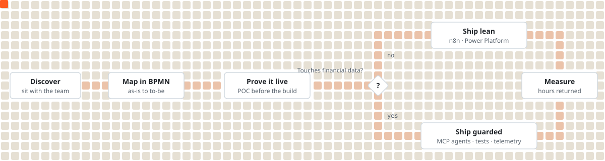

### Hi, I'm Mason

I build automation and agentic workflows that finance and operations teams trust enough to make real decisions on. Analyst by training, builder by habit: I sit with the people closest to a workflow, find the real bottleneck, ship the fix and measure what it saves them.

Currently at **Redbridge Capital**, Melbourne.

 

<picture>
  <source media="(prefers-color-scheme: dark)" srcset="https://raw.githubusercontent.com/masonnguyen131/masonnguyen131/output/terminal-dark.svg" />
  
</picture>

### How the work moves

<picture>
  <source media="(prefers-color-scheme: dark)" srcset="assets/flow-dark.svg" />
  
</picture>

### Things I've built

| Project | What it does | Stack |
|:--|:--|:--|
| **Capital Vision platform** | Property and macro pipelines into ML forecasts, with a Claude API chatbot for buyers | Python · PostgreSQL · AWS S3 · n8n |
| [**Stock Price Predictor**](https://github.com/masonnguyen131/stockprecpp) | Three forecasting models on one candlestick chart | C++ |
| [**Rental AI**](https://github.com/masonnguyen131/Rental-AI) | AI rental helper with map search, built for an IBM hackathon | JavaScript |
| [**House Price Prediction**](https://github.com/masonnguyen131/House_price_Prediction) | Regression, MLP, GRU and LSTM on ~20,000 sales | Python |

### Contributions

<picture>
  <source media="(prefers-color-scheme: dark)" srcset="https://raw.githubusercontent.com/masonnguyen131/masonnguyen131/output/reel-dark.svg" />
  
</picture>

**Stack** &nbsp;`Claude Code` `Claude Skills` `MCP` `n8n` `Power Platform` `Python` `SQL` `Power BI` `BigQuery` `dbt`

**Elsewhere** &nbsp;[Portfolio](https://masonportfolio.vercel.app/) · [LinkedIn](https://www.linkedin.com/in/masonnguyen13/) · [Email](mailto:masonnguyen131@gmail.com)

The terminal is reprinted every morning at 6am Melbourne time by a GitHub Action, with a new line from how I work.
