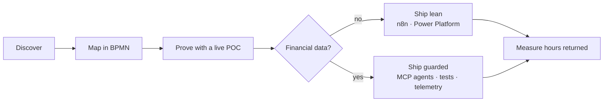

<a href="https://masonportfolio.vercel.app/">
  <picture>
    <source media="(prefers-color-scheme: dark)" srcset="assets/header-dark.svg" />
    
  </picture>
</a>

 

I build automation that teams trust enough to make real decisions on. I sit with the people closest to a workflow, find the real bottleneck, design the fix, deploy it and measure what it saves them. Lately that means *agentic workforces with guardrails*, so the work gets faster without getting riskier.

 

| **5 / 5** | **-40%** | **+25%** |
|:--|:--|:--|
| POCs live in my first four months at Redbridge Capital | operations time per task | team workload capacity |

 

**How the work moves**

 

**Tools** &nbsp; Claude Code · Claude Skills · MCP · n8n · Power Platform · Python · SQL · Power BI · BigQuery · dbt

**Elsewhere** &nbsp; [Portfolio](https://masonportfolio.vercel.app/) · [LinkedIn](https://www.linkedin.com/in/masonnguyen13/) · [Email](mailto:masonnguyen131@gmail.com)
